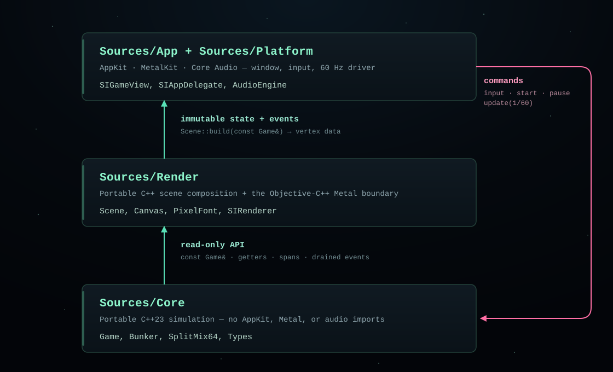

# C++ Design and Coding Choices

This document records the concrete C++ decisions behind SPACE INVADERS — Metal
Arcade: the architecture, ownership model, error policy, determinism rules,
build configuration, and the trade-offs that were deliberately rejected. The
goal is not "modern C++ for its own sake"; it is a small game that is easy to
reason about, test without a window server, and extend without letting gameplay
and rendering become entangled.

## 1. Goals and constraints

The project had five engineering constraints:

1. **One authoritative simulation.** Gameplay must not be duplicated between
   the simulation and the renderer.
2. **Headless verification.** The rules must compile and run without AppKit,
   Metal, audio hardware, or a display.
3. **Determinism.** A fixed input sequence at a fixed timestep must replay the
   same game on any supported Mac.
4. **Native presentation.** Metal, AppKit, and Core Audio are required; an
   engine, framework, or third-party dependency is not.
5. **Procedural assets.** No bitmap, font, or audio files. Every visible and
   audible detail is code.

Those constraints point to a layered design rather than a monolithic "game
class" that owns the window, renderer, audio device, and rules together.



Edges are one-way in source terms. State, events, and vertex data move upward
through const references and `std::span` views; commands move down the
right-hand channel into `Game`. Nothing in `Sources/Core/` includes a header
from `Sources/Render/`, `Sources/Platform/`, or `Sources/App/`, so the
dependency graph and the arrowheads agree.

## 2. The simulation API is command-oriented and read-only

The public entry point is [Game.hpp](../Sources/Core/include/invaders/Game.hpp) —
`Game`. It is a `final` class with no virtual functions and no inheritance.
Presentation can observe it, but all mutation goes through explicit commands:

- `requestStart`, `startNewGame`, `togglePause`, and `pause`;
- `setMoveLeft`, `setMoveRight`, and `setFiring`; and
- `update(float deltaSeconds)`, always called with a fixed step.

State is exposed through `[[nodiscard]]` getters returning values, references,
or `std::span` views into owned storage. There are no public mutable fields and
no friend classes. This matters for two reasons: it keeps the renderer honest,
and it makes every mutation in the codebase greppable.

`Game::update` is the only place time advances. It clamps the supplied delta and
then dispatches to a phase-specific routine in [Game.cpp](../Sources/Core/Game.cpp)
— `Game::updatePlaying`. Within a playing frame the order is fixed: input and
player shot, formation march, shot collision, enemy shot collision, enemy fire,
then the mystery ship. Reordering these calls changes observable gameplay, so
the order is treated as part of the rules, not an implementation detail.

## 3. Ownership and lifetime

Ownership is explicit and RAII-based.

- The app owns exactly one `invaders::Game` through
  `std::unique_ptr<invaders::Game>` in [GameView.mm](../Sources/Platform/GameView.mm)
  — `SIGameView`. The renderer and audio engine are owned by the same view.
- Metal objects are held by [SIRenderer](../Sources/Render/MetalRenderer.mm) —
  `SIRenderer` using ARC-managed Objective-C pointers. Their lifetime is bounded
  by the view's lifetime.
- The simulation owns its aliens, projectiles, events, and bunkers with value
  containers. It holds no pointers into the renderer or platform layer.
- No raw owning pointers are used. Raw references and pointers appear only for
  non-owning function parameters and short-lived loops.
- GPU vertex buffers are triple-buffered to avoid CPU/GPU write races; the
  in-flight semaphore bounds reuse.

A `Pimpl` was not used for `Game`. The header is already small, the project is
built from source, and keeping the private layout visible to the library's own
translation unit makes the code easier to inspect without adding allocation and
indirection. Objective-C++ classes hide their internals naturally in the class
extension in the `.mm` file.

## 4. Value semantics, data layout, and small types

The core uses small value types from [Types.hpp](../Sources/Core/include/invaders/Types.hpp)
— `Vec2`, `Rect`, `Alien`, `Projectile`, `Event`, and `GameOptions`. They are
copyable, trivially destructible, and easy to log or serialise later. Aliens are
stored in a `std::vector<Alien>` of exactly 55 entries; every bunker is a
`std::array<std::uint8_t, 22 * 16>` in [Bunker.hpp](../Sources/Core/include/invaders/Bunker.hpp)
— `Bunker`. Fixed-size storage communicates the invariant and avoids per-frame
allocation for these hot structures.

Enums are `enum class` with explicit underlying types where storage matters
(`AlienKind`, `EventType`). Constants are `inline constexpr` in a namespace,
never macros. The coordinate space is fixed at 224 × 256 logical units; window
and drawable dimensions are presentation concerns only.

`std::optional` is used for the single player shot, and `std::span` gives the
renderer a read-only window into projectiles, aliens, and events without
copying. The renderer never holds a span across simulation updates.

## 5. Determinism

The simulation does not read the wall clock, the display refresh rate, or any
global random device. Random decisions go through [Rng.hpp](../Sources/Core/include/invaders/Rng.hpp)
— `SplitMix64`, seeded from `GameOptions`. That covers enemy-fire column
selection, fire cadence, mystery-ship direction, and mystery-ship points.
`std::sin` and friends are used for presentation only, except for the march
formula, where the deterministic float computation is part of the rules.

The app uses `CACurrentMediaTime()` only to measure frame deltas, then feeds the
simulation a fixed `1/60` step and caps catch-up at eight steps. The simulation
never sees a variable timestep. This makes the check suite's replay assertions
meaningful and prevents high-refresh displays from changing difficulty.

Events are queued as values in `Game` and drained once per fixed step by the
view. They carry the position and points needed for audio and particles, so the
renderer does not re-derive gameplay facts.

## 6. Errors and failure policy

C++ exceptions are not used for gameplay control flow. The simulation's
operations are total: invalid commands are no-ops, collisions are handled with
predicates, and allocation is the only ordinary failure mode. Rendering and
audio failures should degrade gracefully rather than crash:

- Metal shader, pipeline, and buffer creation errors propagate to the AppKit
  initializer as an `NSError` and produce a clear alert.
- The audio engine probes the default output unit and simply disables audio if
  initialization fails. It does not block play.
- If `currentDrawable` or the render pass is unavailable (for example during a
  resize or when the window is off-screen), the frame is skipped.

This is a game, not a library with an ABI contract. Allocation failure is
treated as fatal by the runtime rather than wrapped in error types that no
player could act on.

## 7. Build configuration and warning policy

The build is CMake 3.28+ with Ninja. C++23 is required, extensions are off, and
the deployment target is macOS 13. The root [CMakeLists.txt](../CMakeLists.txt) —
`spaceinvaders_warnings` applies:

```text
-Wall -Wextra -Wpedantic -Wshadow -Wconversion -Wsign-conversion
-Wnon-virtual-dtor -Wold-style-cast -Wformat=2 -Wundef -Wnull-dereference
```

`SPACE_INVADERS_WARNINGS_AS_ERRORS` turns those into errors by default. This is
the project's lint substitute: there is no third-party static analyser, and the
compiler plus the checks are intentionally the complete local gate. The format
gate is [.clang-format](../.clang-format): four-space indentation, 100 columns,
attached braces, east const, and left-aligned pointers.

`clang-format` and `checks` are run by [scripts/check.sh](../scripts/check.sh) —
`CLANG_FORMAT`, followed by a Release build, the regression executable, and the
documentation validator. Sources are built as separate targets:

- `spaceinvaders_core` — no Apple framework dependencies;
- `spaceinvaders_render` — C++ scene composition;
- `spaceinvaders_core_header_checks` and `spaceinvaders_render_header_checks` —
  each portable header compiled as its own translation unit;
- `spaceinvaders_app` — Objective-C++ bridge and AppKit application; and
- `spaceinvaders_checks` — the headless executable.

Splitting the targets means the core's dependency hygiene is enforced by the
build graph, not just by convention.

## 8. The Objective-C++ boundary

Metal's API is Objective-C. Trying to hide that behind a pure C++ abstraction
would either expose opaque handles and manual retain/release semantics or
duplicate the API. The project instead uses a narrow Objective-C++ layer:

- [MetalRenderer.mm](../Sources/Render/MetalRenderer.mm) — `SIRenderer` owns the
  device, command queue, pipeline, and vertex buffers, and accepts a const
  reference to `Game`.
- [GameView.mm](../Sources/Platform/GameView.mm) — `drawInMTKView` runs the fixed
  step and forwards events to audio and scene.
- [AppDelegate.mm](../Sources/App/AppDelegate.mm) — `createWindow` owns window and
  menu setup.
- `main.mm` starts `NSApplication`.

The pure C++ side has no `#import`, no ARC types, and no Cocoa ownership. The
scene itself is portable C++ and could be driven by another renderer later.

## 9. Rendering choices

The renderer uses one vertex format (`x, y, r, g, b, a`), one pipeline, and one
draw call per frame. [Canvas.cpp](../Sources/Render/Canvas.cpp) — `Canvas::addRect`
and its siblings expand circles, lines, rings, and glyph cells into triangles.
[Scene.cpp](../Sources/Render/Scene.cpp) — `Scene::build` composes the full frame
back-to-front. [PixelFont.cpp](../Sources/Render/PixelFont.cpp) — `PixelFont::draw`
emits text as rectangles rather than platform text.

This is deliberately not a retained scene graph or a sprite batcher. At this
scale—tens of thousands of vertices per frame—immediate mode is simpler,
produces a single draw call, and makes procedural art easy to iterate on. Art
belongs to presentation, not gameplay: alien shapes are chosen from an enum,
but collision rectangles live in `Game::alienRect`.

The MSL lives in [MetalShaders.hpp](../Sources/Render/MetalShaders.hpp) —
`arcade_vertex` and is compiled at runtime. This keeps the repository free of
precompiled `.metallib` binaries but means a successful C++ build is not proof
that the shader works. Manual launch after shader changes is mandatory.

## 10. Audio choices

[AudioEngine.cpp](../Sources/Platform/AudioEngine.cpp) — `AudioEngine::renderFrames`
uses the C Core Audio output unit. A single-producer/single-consumer ring buffer
carries sound events from the main thread to the real-time callback. Voices are
a fixed array; the callback does no allocation, locking, or Objective-C work.
The engine fails closed to silence if the output unit is unavailable.

A higher-level AVFoundation graph would be more idiomatic for an app but adds
Objective-C object lifetimes and a larger API surface for no audible benefit at
this scale. The C API keeps the synthesis loop explicit and platform-contained.

## 11. Testing choices

[Checks/main.cpp](../Checks/main.cpp) — `checkInvariants` is a plain executable with
a `check(bool, message)` helper, not XCTest or GoogleTest. It uses only the
public simulation API. Tests simulate real input and step real frames; there are
no production "test-only" mutation methods. That forces the API to be sufficient
for autopilot logic, and it keeps the checks independent of the window server,
Metal device, and audio hardware.

The suite includes a 60-second soak with per-frame invariants, deterministic
replay comparisons, an autopilot that clears an entire wave, and an autopilot
that intercepts the mystery ship. Because everything is deterministic, failures
are reproducible from the seed and input schedule in the test.

## 12. Trade-offs and rejected alternatives

| Alternative | Why it was not used |
| --- | --- |
| Entity-component-system | 55 aliens, four bunkers, and a handful of projectiles do not justify indirection, archetype storage, or a scheduler. A vector of values is clearer. |
| Deep class hierarchy (`AlienBase`, `PlayerBase`) | No polymorphic behaviour is needed. `enum class AlienKind` plus data tables keeps dispatch local and cheap. |
| Exceptions for invalid commands | Gameplay commands are naturally total; no-ops are safer for frame loops and easier to reason about. |
| `shared_ptr` everywhere | There is a single owner for each resource. `unique_ptr` and value members express that. |
| Hidden global game state | It would make multiplayer/testing/replay harder and discourage explicit dependencies. State lives in `Game`. |
| Text/JSON configuration files | The rules are code. Runtime configuration would complicate packaging and create an asset to validate without a player-facing need. |
| Dynamic sprite textures | The art is small, pixel-based, and procedural. Triangles avoid texture atlases and asset rights concerns. |
| Modules | Build complexity and toolchain churn outweigh the inclusion model for a project this size. |
| Third-party unit-test framework | A 250-line dependency-free executable keeps setup trivial; the public API constraint is more valuable than test fixtures. |

## 13. Style cheat sheet

- Namespace everything in `invaders` (or `invaders::render`,
  `invaders::platform`).
- Types are `PascalCase`; functions, methods, and variables are `camelCase`;
  constants are `kPascalCase`.
- Prefer `const` and `constexpr`; put `const` after the type: `const Game&`.
- Use trailing return types on declarations for consistency with the existing
  code: `auto update(float dt) -> void`.
- Mark getters `[[nodiscard]]` and operations that cannot throw `noexcept`.
- Use `std::size_t` loops for containers and explicit casts for numeric
  conversions; the warning set rejects silent narrowing.
- Keep headers self-contained and include what you use; the build compiles each
  portable header as its own translation unit so a missing include cannot hide
  behind a transitive one.
- Keep Objective-C++ in `.mm`; keep `.cpp` files free of Apple imports.
- Add a check when behaviour changes; update a citing document when a symbol
  changes.

## 14. Evolution rules

New features should preserve the dependency direction and the public/private
split before adding abstractions. If a future feature needs a second renderer
or platform, the scene API is the seam to extend. If the entity count grows by
orders of magnitude, revisit the "values in vectors" decision as a measured
refactor recorded under [Docs/Refactoring/](Refactoring/README.md), not as an
unrelated drive-by rewrite.
