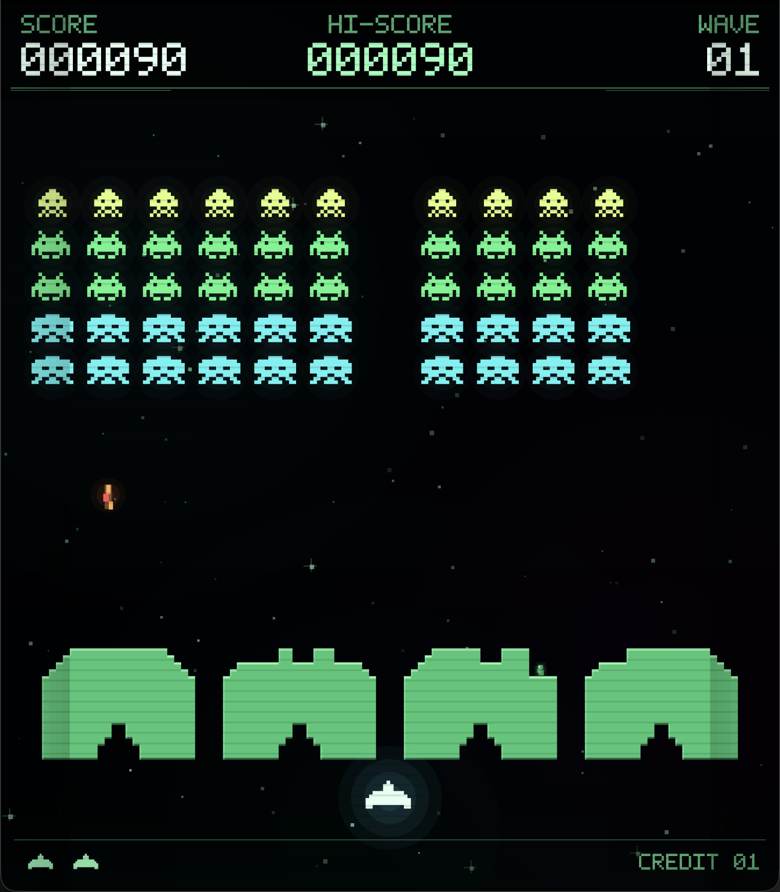

# SPACE INVADERS — Metal Arcade

A complete, native macOS tribute to Taito's 1978 arcade game, written from
scratch in modern C++23 and rendered entirely with Metal. There are no sprite
sheets, no game engine, no downloaded assets, and no third-party runtime
dependencies: the aliens, cannon, bunkers, pixel font, star field, app icon,
and arcade sound effects are all generated procedurally.

Canonical source:
<https://github.com/dlcmh/1978-space-invaders-in-cpp-on-macos>



## Play

From a fresh clone:

```bash
git clone https://github.com/dlcmh/1978-space-invaders-in-cpp-on-macos.git
cd 1978-space-invaders-in-cpp-on-macos
make app
open dist/SPACE-INVADERS.app
```

To produce a distributable disk image as well:

```bash
make dmg
# dist/SPACE-INVADERS-1.0.dmg
```

Generated bundles under `dist/` are intentionally not committed. For a direct
development launch:

```bash
make run
```

Requires macOS 13 or newer on a Metal-capable Mac, Apple Command Line Tools
(or Xcode), CMake 3.28+, Ninja, and `clang-format`. No package manager or
third-party library is used by the game.

## Controls

| Key | Action |
| --- | --- |
| ← / → or A / D | Move the laser cannon |
| Space | Fire / start a new game |
| Return | Start a new game |
| P | Pause / resume |
| Esc | Pause |
| M | Mute / unmute |
| ⌘N | New game |
| ⌘P / ⌘M | Pause / mute menu shortcuts |
| ⌃⌘F | Toggle full screen |

The window is resizable and preserves the arcade board's portrait aspect ratio.
Sound can be muted at any time, and both the mute setting and the local high
score are remembered between launches.

## What is implemented

- The canonical **55-invader formation**: 11 columns by 5 rows, with three
  species worth **30 / 20 / 10 points** and two-frame marching animation.
- A side-to-side formation that steps downward at each wall. The march timer
  shortens as aliens are destroyed, so the last few invaders genuinely speed
  up, just as the original's frame-rate-driven behaviour did.
- One player laser at a time, enemy fire from the lowest surviving alien in a
  randomly chosen column, and escalating fire pressure across waves.
- **Four destructible bunkers** represented as 22 × 16 pixel grids. Shots carve
  irregular holes out of the same cells the renderer draws, and the descending
  formation erodes cover it marches through.
- A bonus **Mystery Ship** that crosses the top of the screen for
  **50 / 100 / 150 / 300** points.
- Lives, wave progression, a persistent local high score, game over, pause,
  mute, and deterministic fixed-step play at 60 Hz.
- A single-draw-call Metal renderer with 4× MSAA, CRT scanlines, glow, particle
  bursts, floating score callouts, and a custom 5 × 7 procedural pixel font.
- Procedural chiptune-style audio synthesized through Core Audio at launch.

## Project layout

```
Sources/Core/              Portable C++23 simulation (no Apple frameworks)
  include/invaders/        Public types, Game API, Bunker, deterministic RNG
  Game.cpp                 Movement, marching, fire, collisions, phases
  Bunker.cpp               Shield bitmap, hit testing, pixel carving
Sources/Render/            Portable C++ scene composition
  Canvas.cpp               Immediate-mode triangle primitives
  PixelFont.cpp            5x7 procedural font
  Scene.cpp                Backdrop, HUD, sprites, overlays, effects
  MetalRenderer.mm         Objective-C++ Metal bridge and single draw call
  MetalShaders.hpp         Inline Metal Shading Language
Sources/Platform/          AppKit/MetalKit window, input, Core Audio
Sources/App/               Application entry point and menus
Checks/                    Dependency-free simulation regression suite
scripts/                   App bundle, icon, format, docs, and check gates
Resources/                 Info.plist and generated app icon
Docs/                      Screenshots, architecture, Q&A, Metal crash course
  QnA/                     Source-grounded answers to individual questions
  Refactoring/             Dated records of evaluated refactoring decisions
```

The simulation is deliberately independent of AppKit and Metal so it can be
tested headlessly and reasoned about like any other C++ library.

## Why this C++ architecture

The short version: a portable, dependency-free C++ simulation; a pure C++
scene-composition layer; and one carefully contained Objective-C++ boundary
where Apple's APIs are unavoidable.

- `Game` has **no UI, audio, clock, or Metal imports** and exposes read-only
  state plus explicit commands.
- The presentation layer consumes a small immutable event stream rather than
  reaching into simulation internals.
- Objective-C++ is confined to `MetalRenderer.mm` and the AppKit platform
  layer. The C++ choices, ownership model, warning policy, and trade-offs are
  documented in [Docs/CPP_DESIGN.md](Docs/CPP_DESIGN.md).

Read [Docs/QnA/](Docs/QnA/README.md) for focused explanations of the
simulation/render split, bunker destruction, the slowing march, the Metal draw
call, and the audio engine.

## Verification

```bash
make check
```

`make check` is the gate every change must pass:

1. `clang-format --dry-run --Werror` over all C++/Objective-C++ sources;
2. a **Release** CMake build with `-Werror` and a strict warning set;
3. the headless `spaceinvaders_checks` regression suite; and
4. documentation links, heading anchors, and cited symbols.

The current baseline is **24,343 checks**, covering formation integrity,
movement clamping, one-shot firing, alien and bunker collisions, marching,
wave progression, mystery-ship spawning and scoring, pause behavior, death,
game over, deterministic replay, and a fixed-step soak run. Checks use only the
public `Game` API; there are no test-only mutation hooks in production code.

Rendering changes require a manual launch as well: Metal shaders compile at
runtime, so a successful build alone cannot prove that a frame is visible.
The app was launched and visually verified on the commissioning host, and the
screenshots in `Docs/` were captured from the running app.

For screenshots or smoke tests, two development-only environment variables are
available: `SPACEINVADERS_AUTOSTART=1` starts a game immediately, and
`SPACEINVADERS_AUTOPAUSE=0` disables auto-pause when the app loses focus.

## New to Metal?

[Docs/METAL_CRASH_COURSE.md](Docs/METAL_CRASH_COURSE.md) starts from "what is
the GPU actually doing?" and walks through this renderer's shaders, vertex
buffer, single draw call, blending, MSAA resolve, and triple buffering using the
actual source. It assumes no Metal or graphics background.

## Project and governance

- [Project origin](Docs/PROJECT_ORIGIN.md) — the original commission and scope
  decisions
- [C++ design](Docs/CPP_DESIGN.md) — architecture, ownership, and style choices
- [Contributing](CONTRIBUTING.md)
- [Governance](GOVERNANCE.md)
- [Security policy](SECURITY.md)
- [Agent instructions](AGENTS.md)

No open-source license has been selected for this repository; see the
governance policy before reusing or redistributing any part of it.

## Notes

SPACE INVADERS is a trademark of TAITO Corporation. This is a fan-made,
non-commercial technical tribute and is not affiliated with or endorsed by
TAITO. All artwork, audio, and code in this repository are original procedural
work. The original 1978 game's discrete-logic quirks are acknowledged as
history; emulating the arcade ROM is not a goal of this project.
